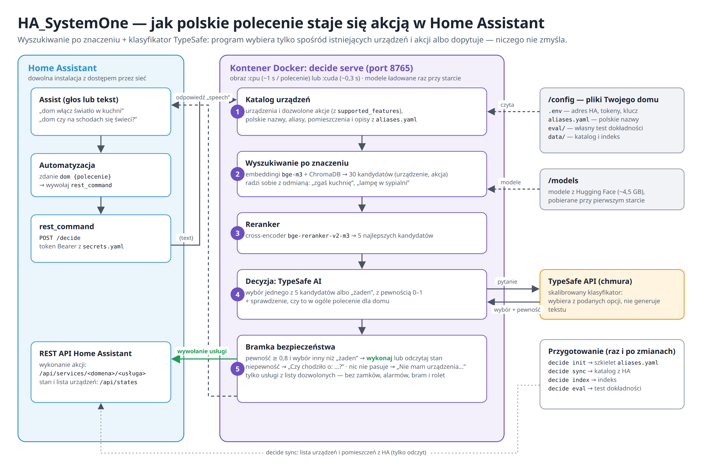

# HA_SystemOne

**Steruj domem w Home Assistant zwykłymi zdaniami po polsku.**

Piszesz (albo mówisz) w Assist: *„dom włącz światło w sypialni”*, a program sam
domyśla się, o które urządzenie i o jaką akcję chodzi, i wykonuje ją w Home
Assistant (HA). Możesz też zapytać: *„dom czy w kuchni świeci się światło?”* —
wtedy tylko sprawdza stan i odpowiada.

Jeśli program **nie jest pewien**, o co chodzi, **nic nie robi** i dopytuje:
*„Nie jestem pewien. Czy chodziło o: Telewizor, Ekran telewizora, Podświetlenie telewizora?”*



---

## Spis treści

1. [Jak to działa (w prostych słowach)](#jak-to-działa-w-prostych-słowach)
2. [Czego potrzebujesz](#czego-potrzebujesz)
3. [Instalacja](#instalacja)
4. [Instalacja w Dockerze (zalecana)](#instalacja-w-dockerze-zalecana)
5. [Pierwsze uruchomienie (bez ryzyka)](#pierwsze-uruchomienie-bez-ryzyka)
6. [Połączenie z Home Assistant](#połączenie-z-home-assistant)
7. [Dopasowanie do swojego domu](#dopasowanie-do-swojego-domu-aliasesyaml)
8. [Co potrafi](#co-potrafi)
9. [Bezpieczeństwo](#bezpieczeństwo)
10. [Gdy coś nie działa](#gdy-coś-nie-działa)
11. [Słowniczek](#słowniczek)
12. [Dla programistów](#dla-programistów)

---

## Jak to działa (w prostych słowach)

Program zna listę Twoich urządzeń z HA i to, co każde z nich potrafi
(włączyć, wyłączyć, ściemnić, ściszyć…). Gdy dostaje polecenie, przechodzi
przez trzy etapy — jak sito, które za każdym razem jest drobniejsze:

```
„włącz światło w sypialni”
   │
   ├─ 1. Wyszukiwanie   — spośród ~100 możliwych akcji (ok. 1200 przykładowych zdań)
   │                       wybiera 30 najbardziej podobnych do Twojego (model bge-m3)
   ├─ 2. Ranking        — dokładniej porównuje i zostawia 5 najlepszych
   │                       (model bge-reranker-v2-m3)
   ├─ 3. Decyzja        — TypeSafe AI wybiera jedną z tych 5 albo „żadna”
   │                       i mówi, jak bardzo jest pewien (np. 0,97)
   │
   └─ pewność ≥ 0,8?  → TAK: wykonuje akcję w HA
                      → NIE: nic nie robi i dopytuje
```

Cały przepływ — od Assist w HA, przez kontener, z powrotem do HA — pokazuje
[schemat na górze strony](docs/architecture.png) (źródło: `docs/architecture.html`).

Ważne: TypeSafe **niczego nie wymyśla**. Może tylko wybrać z listy, którą mu
podamy. Dzięki temu nie „zgaduje” nazw urządzeń, które nie istnieją.

Dwa pierwsze modele działają **lokalnie na Twoim komputerze**. Do TypeSafe
wysyłane jest tylko polecenie i opisy 5 kandydatów.

---

## Czego potrzebujesz

- **Home Assistant** z dostępem przez sieć (np. `http://homeassistant.local:8123`).
- **Komputer z Linuksem** (lub inny z Pythonem 3.12+), na którym będzie działał
  program. Karta graficzna NVIDIA przyspiesza działanie, ale nie jest wymagana.
- Polecenia **po polsku** — szablony zdań i odpowiedzi są tylko po polsku.
- Ok. **4,5 GB miejsca** na modele (pobiorą się same przy pierwszym uruchomieniu).
- **[Docker](https://docs.docker.com/engine/install/)** z Compose (zalecane) **albo**
  narzędzie **[uv](https://docs.astral.sh/uv/)** do instalacji Pythona i bibliotek.
- **Token dostępu do HA** (Long-Lived Access Token): w HA kliknij swój profil
  (lewy dolny róg) → zakładka **Bezpieczeństwo** → **Tokeny dostępu
  długoterminowego** → **Utwórz token**.
- **Klucz API TypeSafe** z [typesafe.ai](https://typesafe.ai).

---

## Instalacja

```bash
git clone https://github.com/jarekmor/HA_SystemOne.git
cd HA_SystemOne
uv sync
```

`uv sync` instaluje PyTorch z wersją dla kart NVIDIA (na Linuksie). **Bez karty
NVIDIA** użyj mniejszej wersji na sam procesor:

```bash
uv sync --extra cpu
```

i wtedy dopisuj `--extra cpu` także do każdego `uv run` (np. `uv run --extra cpu decide sync`),
inaczej uv doinstaluje wersję z NVIDIA.

Następnie utwórz plik z ustawieniami:

```bash
cp .env_example .env
```

i uzupełnij go w edytorze tekstu:

```ini
HA_URL=http://homeassistant.local:8123
HA_TOKEN=tu-wklej-token-z-HA
TYPESAFE_API_KEY=tu-wklej-klucz-TypeSafe
```

> Plik `.env` zawiera hasła — **nie wysyłaj go nikomu** i nie wrzucaj do
> repozytorium (jest już dodany do `.gitignore`).

---

## Instalacja w Dockerze (zalecana)

Docker uruchamia serwer w tle, sam go wznawia po restarcie komputera i nie
wymaga instalowania Pythona. Twoje pliki (`.env`, `aliases.yaml`,
`eval/commands.yaml`, `data/`) zostają w katalogu projektu — kontener tylko je
czyta i zapisuje. Modele (~4,5 GB) pobiorą się przy pierwszym starcie do
osobnego wolumenu Dockera.

```bash
git clone https://github.com/jarekmor/HA_SystemOne.git
cd HA_SystemOne
cp .env_example .env          # i uzupełnij jak w rozdziale „Instalacja”
docker compose pull           # gotowy obraz (albo: docker compose build)
```

Są dwa obrazy:

| Obraz | Rozmiar | Szybkość odpowiedzi | Kiedy |
|---|---|---|---|
| `:cpu` (domyślny) | ~1,8 GB | ok. 0,7–1,4 s | każdy komputer |
| `:cuda` | ~6,5 GB | ok. 0,3 s | karta NVIDIA + [NVIDIA Container Toolkit](https://docs.nvidia.com/datacenter/cloud-native/container-toolkit/latest/install-guide.html), sterownik ≥ 580 |

(Czasy zmierzone na Ryzen 7 7800X3D / RTX 5060 Ti, razem z zapytaniem do TypeSafe.)

Dla karty NVIDIA dopisz do `.env` jedną linię — wtedy każde `docker compose …`
użyje obrazu `:cuda`:

```ini
COMPOSE_FILE=compose.yaml:compose.gpu.yaml
```

Polecenia z dalszej części instrukcji uruchamiasz w kontenerze, zamieniając
`uv run decide` na `docker compose run --rm decide`, np.:

```bash
docker compose run --rm decide init
docker compose run --rm decide sync
docker compose run --rm decide index
docker compose run --rm decide "włącz światło w sypialni" -v
```

Serwer uruchamiasz raz — potem działa w tle:

```bash
docker compose up -d          # start (także po restarcie komputera)
docker compose logs -f        # podgląd, Ctrl+C kończy podgląd
docker compose ps             # stan: „healthy” = gotowy
docker compose restart        # po zmianie aliases.yaml + decide sync/index
docker compose down           # zatrzymanie
```

> **Zapora (ufw) a Docker:** porty wystawione przez Dockera **omijają reguły
> ufw**. Jeśli chcesz, żeby do serwera mógł się łączyć tylko HA (rozdz.
> „Połączenie z Home Assistant”, krok 3), utwórz obok `compose.yaml` plik
> `compose.override.yaml` (jest w `.gitignore`):
>
> ```yaml
> services:
>   decide:
>     network_mode: host
>     ports: !reset []
> ```
>
> Wtedy serwer słucha bezpośrednio na porcie 8765 komputera i reguła ufw
> działa. Gdy w `.env` jest `COMPOSE_FILE`, dopisz do niego
> `:compose.override.yaml`.

---

## Pierwsze uruchomienie (bez ryzyka)

Domyślnie program **niczego nie przełącza** — tylko pokazuje, co by zrobił
(tzw. *dry-run*, „na sucho”).

**1. Utwórz plik dopasowania do swojego domu:**

```bash
uv run decide init
```

Program pobierze z HA listę pomieszczeń i urządzeń i zapisze szkielet
`aliases.yaml`. Na razie możesz go zostawić — wrócisz do niego w rozdziale
[Dopasowanie do swojego domu](#dopasowanie-do-swojego-domu-aliasesyaml).

**2. Pobierz listę urządzeń z HA:**

```bash
uv run decide sync
```

Zobaczysz listę urządzeń z nazwami, pomieszczeniami i dostępnymi akcjami.

**3. Zbuduj indeks wyszukiwania:**

```bash
uv run decide index
```

**4. Wypróbuj polecenie** (użyj nazwy urządzenia z listy z kroku 2):

```bash
uv run decide "włącz światło w sypialni"
```

Wynik wygląda mniej więcej tak:

```
Dry-run (dodaj --execute): POST /api/services/switch/turn_on {'entity_id': 'switch.bedroom_relay'}
```

Czyli: „włączyłbym przełącznik `switch.bedroom_relay`”. Dodaj `-v`, żeby zobaczyć
wszystkie etapy decyzji.

**5. Naprawdę wykonaj polecenie** (dopiero gdy dry-run wygląda dobrze):

```bash
uv run decide "włącz światło w sypialni" --execute
```

Pytania o stan („czy…”, „co gra…”) nic nie zmieniają, więc działają bez `--execute`.

---

## Połączenie z Home Assistant

Uruchamianie z terminala jest wygodne do testów, ale za każdym razem ładuje
modele (~10 s). Do codziennego użytku program działa jako **serwer**: ładuje
modele raz, a potem odpowiada w ok. 0,3 s (z kartą NVIDIA; na samym procesorze ok. 1 s). HA wysyła do niego polecenia
z Assist i odczytuje odpowiedź.

```
Assist w HA  ──„dom włącz światło”──▶  serwer decision_ha  ──▶  odpowiedź „Wykonano: …”
                                            │
                                            └──▶ wywołanie usługi w HA (np. switch.turn_on)
```

### Krok 1. Ustaw hasło dla serwera

Serwer wykona akcję tylko wtedy, gdy HA poda prawidłowy token. Wygeneruj go
i dopisz do `.env`:

```bash
echo "DECISION_API_TOKEN=$(openssl rand -hex 32)" >> .env
```

Bez tego tokenu serwer działa wyłącznie „na sucho”.

### Krok 2. Uruchom serwer

W Dockerze: `docker compose up -d` (patrz [Instalacja w Dockerze](#instalacja-w-dockerze-zalecana)).
Bez Dockera:

```bash
uv run decide serve --host 0.0.0.0
```

- `--host 0.0.0.0` — serwer jest widoczny w sieci domowej (potrzebne, gdy HA
  działa na innym urządzeniu niż ten komputer). Bez tej opcji serwer
  słucha tylko na tym komputerze.
- Domyślny port to **8765** (zmienisz go opcją `--port`).
- Po ok. 15 s serwer jest gotowy. Sprawdzisz to w przeglądarce:
  `http://<IP-komputera>:8765/health` → `{"status":"ok"}`.

IP komputera sprawdzisz poleceniem `hostname -I`. Warto ustawić w routerze
**stały adres IP** dla tego komputera, żeby HA zawsze go znalazł.

### Krok 3. Otwórz port w zaporze (jeśli używasz ufw)

Pozwól łączyć się z serwerem **tylko** urządzeniu z HA:

```bash
sudo ufw allow from <IP-HA> to any port 8765 proto tcp comment 'HA -> decision_ha'
```

IP Home Assistanta znajdziesz w HA: **Ustawienia → System → Sieć**.

W Dockerze ta reguła działa tylko z `network_mode: host` — patrz uwaga
o zaporze w [Instalacji w Dockerze](#instalacja-w-dockerze-zalecana).

### Krok 4. Dodaj token do `secrets.yaml` w HA

`secrets.yaml` to plik w katalogu konfiguracji HA (tam, gdzie
`configuration.yaml`). Dopisz:

```yaml
decision_ha_auth: "Bearer <wartość DECISION_API_TOKEN z pliku .env>"
```

Słowo `Bearer` i spacja po nim są wymagane.

### Krok 5. Dodaj polecenie REST do `configuration.yaml`

```yaml
rest_command:
  decision_ha:
    url: "http://<IP-komputera>:8765/decide"
    method: POST
    headers:
      Authorization: !secret decision_ha_auth
    content_type: "application/json"
    payload: '{"text": {{ text | tojson }}, "execute": true}'
    timeout: 15
```

To tworzy w HA nową akcję `rest_command.decision_ha`, która wysyła tekst do
serwera. Następnie **zrestartuj HA** (Ustawienia → System → Uruchom ponownie).

**Test:** w HA otwórz **Narzędzia deweloperskie → Akcje**, przełącz na tryb YAML
i wpisz:

```yaml
action: rest_command.decision_ha
data:
  text: "czy w kuchni świeci się światło?"
```

Kliknij **Wykonaj akcję**. W odpowiedzi powinno być `status: 200` i pole
`speech` z odpowiedzią po polsku.

### Krok 6. Dodaj automatyzację dla Assist

W HA: **Ustawienia → Automatyzacje i sceny → Utwórz automatyzację →
Utwórz nową automatyzację**, potem menu **⋮ → Edytuj w YAML** i wklej:

```yaml
alias: "Polecenie przez decision_ha"
description: "Polskie polecenia z Assist („dom …”) → serwer decision_ha → odpowiedź"
mode: queued
max: 5
triggers:
  - trigger: conversation
    command:
      - "dom {polecenie}"
conditions: []
actions:
  - action: rest_command.decision_ha
    data:
      text: "{{ trigger.slots.polecenie }}"
    response_variable: odpowiedz
    continue_on_error: true
  - set_conversation_response: >-
      
        Serwer decision_ha nie odpowiada.
      
        {{ odpowiedz.content.speech }}
      
        Błąd serwera decision_ha ({{ odpowiedz.status }}).
      
```

Co tu się dzieje:

- **`trigger: conversation`** — automatyzacja startuje, gdy w Assist napiszesz
  lub powiesz coś zaczynającego się od **„dom”**. Wszystko po „dom” trafia do
  zmiennej `polecenie`. Słowo „dom” oddziela Twoje polecenia od wbudowanych
  poleceń HA.
- **`rest_command.decision_ha`** — wysyła tekst do serwera; odpowiedź zapisuje
  w zmiennej `odpowiedz`.
- **`continue_on_error`** — gdy serwer jest wyłączony, automatyzacja nie
  przerywa się, tylko mówi „Serwer decision_ha nie odpowiada”.
- **`set_conversation_response`** — to, co Assist Ci odpowie.
- **`mode: queued`** — kilka poleceń pod rząd wykona się po kolei, żadne nie zginie.

### Krok 7. Wypróbuj

Otwórz Assist (ikona 💬 w prawym górnym rogu pulpitu) i wpisz:

| Polecenie | Odpowiedź |
|---|---|
| dom czy w kuchni świeci się światło? | Światło w kuchni jest wyłączone. |
| dom włącz światło w sypialni | Wykonano: switch.turn_on (Sypialnia światło). |
| dom wyłącz telewizor | Nie jestem pewien. Czy chodziło o: Telewizor, Ekran telewizora, Podświetlenie telewizora? |
| dom jaka jest pogoda w Paryżu | Nie rozumiem polecenia. |

Polecenia głosowe po polsku wymagają asystenta głosowego z polskim
rozpoznawaniem mowy: **Ustawienia → Asystenci głosowi**.

---

## Dopasowanie do swojego domu: `aliases.yaml`

Każdy dom jest inny. Nazwy urządzeń w HA bywają techniczne
(`switch.sonoff_basic_relay_2`) albo po angielsku. W pliku `aliases.yaml` uczysz
program, jak **Ty** mówisz o swoich urządzeniach.

`uv run decide init` tworzy ten plik z danych Twojego HA: wszystkie pomieszczenia
i (w komentarzach) wszystkie urządzenia, którymi program może sterować. Pełny
przykład z objaśnieniami jest w `aliases.example.yaml`. Plik `aliases.yaml` jest
w `.gitignore` — to Twoje ustawienia, nie trafiają do repozytorium (zrób sobie
kopię zapasową).

Przykład:

```yaml
# Pomieszczenia z HA → polska nazwa i forma „gdzie”
areas:
  Bedroom: {name: sypialnia, where: w sypialni}

# Urządzenia, które program ma pomijać
exclude:
  - "media_player.undefined_undefined_*"

# Dodatkowe nazwy i opisy urządzeń
entities:
  switch.bedroom_relay:
    aliases: [światło w sypialni, lampa w sypialni]
    description: główne oświetlenie sypialni (przekaźnik)
```

- **`aliases`** — inne nazwy, których używasz w mowie („lampa w sypialni”).
- **`description`** — krótki opis; pomaga odróżnić podobne urządzenia
  (np. „główne światło” i „mała dioda statusowa na tym samym przekaźniku”).
- **`name`**, **`area`** — nadpisują nazwę i pomieszczenie z HA.
- **`exclude: true`** — pomija dane urządzenie.
- **`where`** w `areas` — polska forma „gdzie” („w sypialni”); program nie
  odmienia nazw sam, więc wpisz ją ręcznie.

### Własny zestaw testowy: `eval/commands.yaml`

`decide eval` sprawdza, czy program dobrze rozumie Twoje polecenia. Skopiuj
przykład i wpisz w nim zdania, których naprawdę używasz, z nazwami encji ze
swojego HA:

```bash
cp eval/commands.example.yaml eval/commands.yaml
```

Ten plik też jest w `.gitignore`. Najważniejszy wynik to
**„błędna akcja zaakceptowana: 0”** — program może się czasem wstrzymać, ale nie
powinien wykonać złej akcji.

Po każdej zmianie odśwież dane i sprawdź, czy nic się nie zepsuło:

```bash
uv run decide sync && uv run decide index && uv run decide eval
```

Jeśli działa serwer, zrestartuj go (Ctrl+C i ponownie `uv run decide serve --host 0.0.0.0`).

**Wskazówka:** gdy program często dopytuje o to samo, zwykle wystarczy dodać
alias lub opis — nie zmieniaj progu pewności.

---

## Co potrafi

| Rodzaj polecenia | Przykład | Co robi w HA |
|---|---|---|
| włącz / wyłącz / przełącz | „zgaś kuchnię” | `turn_on` / `turn_off` / `toggle` |
| jasność | „schody na 30%”, „przyciemnij schody” | ustawia jasność lub zmienia o 20% |
| kolor | „ambilight na czerwono” | ustawia kolor światła |
| głośność | „głośność głośnika 35%”, „ścisz telewizor” | ustawia lub zmienia głośność |
| multimedia | „pauza na dekoderze”, „następny utwór” | odtwarzanie, pauza, następny/poprzedni |
| pytanie o stan | „czy na schodach się świeci?” | tylko odczytuje stan i odpowiada |

Obsługiwane typy urządzeń: światła, przełączniki, przełączniki pomocnicze
(`input_boolean`), odtwarzacze multimedialne, piloty, wentylatory, przyciski,
sceny, skrypty, listy wyboru.

**Czego nie potrafi (na razie):** odczytu czujników (np. temperatury),
sterowania zamkami, alarmami, bramami i roletami — te ostatnie są celowo
wyłączone ze względów bezpieczeństwa.

---

## Bezpieczeństwo

- **Domyślnie nic nie jest wykonywane.** W terminalu potrzeba `--execute`,
  a serwer bez `DECISION_API_TOKEN` działa tylko „na sucho”.
- **Gdy program nie jest pewien (pewność < 0,8), nic nie robi** i dopytuje.
- **Lista dozwolonych akcji.** Program może wysłać do HA tylko akcje z listy
  `ALLOWED` w `src/decision_ha/actions.py`. Zamków, alarmów, bram i rolet
  na niej nie ma.
- **Serwer wymaga tokenu.** Bez prawidłowego nagłówka `Authorization` odrzuca
  polecenia (błąd 401). Ogranicz też dostęp w zaporze tylko do IP HA.
- Hasła i klucze trzymaj wyłącznie w pliku `.env`.

---

## Gdy coś nie działa

| Objaw | Co sprawdzić |
|---|---|
| `Missing HA_URL and/or HA_TOKEN` | Czy plik `.env` istnieje i ma uzupełnione wartości. |
| `401 Unauthorized` przy `decide sync` | Token HA jest błędny lub wygasł — utwórz nowy. |
| `Brak kandydatów — czy indeks jest zbudowany?` | Uruchom `uv run decide sync` i `uv run decide index`. |
| W HA brak akcji `rest_command.decision_ha` | HA nie został zrestartowany albo w YAML jest błąd (Ustawienia → System → Logi). |
| Assist: „Serwer decision_ha nie odpowiada” | Czy serwer działa? Czy uruchomiono go z `--host 0.0.0.0`? Czy zapora wpuszcza port 8765? Czy IP komputera się nie zmieniło? |
| Assist: „Błąd serwera decision_ha (401)” | W `secrets.yaml` brakuje słowa `Bearer ` albo token jest inny niż w `.env`. |
| Assist: „Błąd serwera decision_ha (403)” | Serwer uruchomiono bez `DECISION_API_TOKEN` — dopisz go do `.env` i zrestartuj serwer. |
| Assist: „Błąd serwera decision_ha (502)” | Serwer nie może połączyć się z HA — sprawdź `HA_URL` i `HA_TOKEN`. |
| Ciągle „Nie jestem pewien…” dla jednego urządzenia | Dodaj alias lub opis w `aliases.yaml`. |
| Assist nie reaguje na polecenie | Czy zaczyna się od słowa „dom”? Czy automatyzacja jest włączona? |

---

## Słowniczek

- **Encja** (*entity*) — pojedyncze urządzenie lub jego funkcja w HA,
  np. `light.lampa_salon`.
- **Usługa / akcja** (*service / action*) — polecenie wysyłane do encji,
  np. `light.turn_on`.
- **Assist** — wbudowany w HA asystent, któremu można pisać lub mówić polecenia.
- **Dry-run** — próba „na sucho”: program pokazuje, co by zrobił, ale nic nie zmienia.
- **Token** — długi ciąg znaków działający jak hasło dla programów.
- **Embeddingi / indeks** — sposób zapisania zdań jako liczb, dzięki któremu
  program szybko znajduje zdania o podobnym znaczeniu.
- **Pewność** (*confidence*) — liczba od 0 do 1 mówiąca, jak bardzo model jest
  przekonany do swojego wyboru.

---

## Dla programistów

Polecenia:

```bash
uv sync                 # instalacja zależności
uv run pytest           # testy (HA i TypeSafe zamockowane, bez sieci)
uv run decide init      # szkielet aliases.yaml z HA (nie nadpisuje)
uv run decide sync      # HA → data/catalog.json
uv run decide index     # catalog → data/chroma/
uv run decide "…" -v    # dry-run ze szczegółami
uv run decide eval      # dokładność na eval/commands.yaml
uv run decide serve     # serwer HTTP: POST /decide, GET /health
```

API serwera: `POST /decide` z `{"text": "…", "execute": false}` zwraca
`speech`, `accepted`, `executed`, `entity_id`, `intent`, `call`, `decision`,
`reranked`. Opcjonalne ustawienia w `.env`: `TYPESAFE_MODEL` (np. `jev-1.13.0`),
`DECISION_MIN_CONFIDENCE` (domyślnie 0,8), `DECISION_ALIASES` i `DECISION_EVAL`
(inne ścieżki do `aliases.yaml` i zestawu testowego). Zmienna środowiskowa
`DECISION_DIR` wskazuje katalog z `.env`, `aliases.yaml`, `eval/` i `data/`
(domyślnie katalog projektu; w Dockerze `/config`).

Lokalny serwer decyzji zamiast TypeSafe: [LM Studio](https://lmstudio.ai/docs/developer/jev-compat/systemone)
udostępnia zgodny z Jev endpoint `POST /v1/systemone`. Ustaw w `.env`
`LMSTUDIO_URL=http://127.0.0.1:1234` i `TYPESAFE_MODEL` = identyfikator załadowanego
modelu decyzyjnego (zwykły model czatu nie zadziała); `TYPESAFE_API_KEY` nie jest
wtedy potrzebny. `LMSTUDIO_API_KEY` — tylko gdy w LM Studio włączone jest
„Require Authentication”. Po zmianie uruchom `decide eval` — progi dobrano pod Jev.

Docker: `Dockerfile` buduje dwa warianty (`--build-arg TORCH=cpu|cuda`, odpowiadają
extras `cpu`/`cuda` w `pyproject.toml`). GitHub Actions: `tests.yml` (pytest przy
każdym pushu do `main` i w PR), `docker.yml` (obrazy `ghcr.io/jarekmor/ha_systemone:cpu`,
`:cuda`, `:latest` z `main`; `:X.Y.Z-cpu`/`-cuda` z tagów `vX.Y.Z`).

Struktura:

```
src/decision_ha/
  config.py      # .env, ścieżki, progi, nazwy modeli
  ha_client.py   # REST HA: stany, obszary (template API), usługi
  catalog.py     # filtr encji, intencje z supported_features, aliases.yaml
  templates.py   # polskie szablony zdań i opisy kandydatów
  index.py       # bge-m3 + ChromaDB
  rerank.py      # cross-encoder
  decide.py      # pytania TypeSafe i bramka pewności
  compat.py      # klient LM Studio (/v1/systemone) zamiast TypeSafe
  params.py      # liczby, kolory, opcje z tekstu
  actions.py     # mapowanie na usługi + lista dozwolonych
  execute.py     # odpowiedzi o stanie po polsku
  pipeline.py    # spina etapy
  server.py      # FastAPI: POST /decide, GET /health
  cli.py         # komenda `decide`
tests/           # pytest
Dockerfile, compose.yaml, compose.gpu.yaml   # obrazy i uruchamianie w Dockerze
.github/workflows/           # testy i publikacja obrazów
eval/commands.example.yaml   # przykład zestawu testowego (własny: eval/commands.yaml, w .gitignore)
aliases.example.yaml         # przykład dopasowania (własny: aliases.yaml, w .gitignore)
```

---

## Licencja

MIT — zobacz plik [LICENSE](LICENSE).
